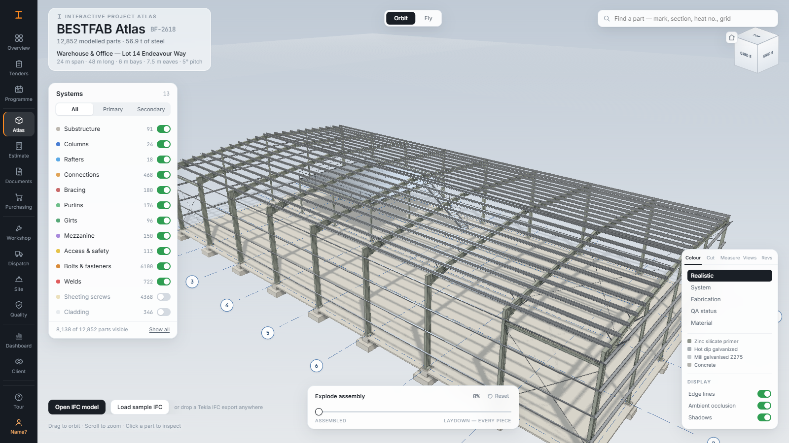

# BESTFAB Atlas

**An interactive 3D atlas of a steel fabrication project.** Think of a human anatomy explorer, applied to a steel building: open a job, spin the structure, pull it apart down to the last purlin cleat, and click any piece to see what it is, what it's made of, where the steel came from, how far through the shop it is, and every certificate attached to it.

## What it does

- **Reads real Tekla IFC4 exports.** Drop an `.ifc` file on the window and the atlas rebuilds around that job: geometry, part marks, assemblies, grades, section profiles, lengths and weights.
- **Detailed to the individual fastener.** The sample building has 12,852 modelled parts, and every bolt, nut, washer, screw and weld is a clickable object with its own mark, mass, standard and certificates.
- **Explode, filter and inspect.** Toggle structural systems, explode the assembly from assembled to laydown, colour by system, fabrication stage, QA status or material, and fly through the model.
- **Runs the job, not just the model.** Tenders and quotes, takeoff and pricing, cutting lists and offcut stock, plate nesting, CNC files, shop loading, hold points and NCRs, QA register, truck loads and lift charts, programme dates, cash flow, and a tamper-evident audit trail.

## Tech stack

| Area | Tools |
| --- | --- |
| App | React, TypeScript, Vite, Zustand |
| 3D | three.js, web-ifc for IFC parsing |
| Documents | pdf-lib, pdfjs, Excel import and export, QR codes |
| Quality | Vitest test suite and stress tests on buildings up to 43,000 parts |

## How it was built

I built BESTFAB Atlas myself, from the 3D viewer and IFC loader to the estimating, workshop and QA tools. I used AI coding tools to speed up the first version, then set up a Vitest suite that checks the takeoff, pricing, cutting lists, nesting, QA register, audit trail and more before each deploy, plus stress tests on buildings up to 43,000 parts.

## Source code

**Source is private (built as a pilot for a steel fabrication business). Demo or code walkthrough available on request.**

The app runs entirely on generated sample data: the IFC model is generated by a script, the framing plan is a made-up sample, and the rates are placeholder benchmarks, not any company's prices.

**Built by Omar Al Azhari** · [LinkedIn](https://www.linkedin.com/in/omar-al-azhari-028a6a203) · [GitHub](https://github.com/Omar-Azhari)
